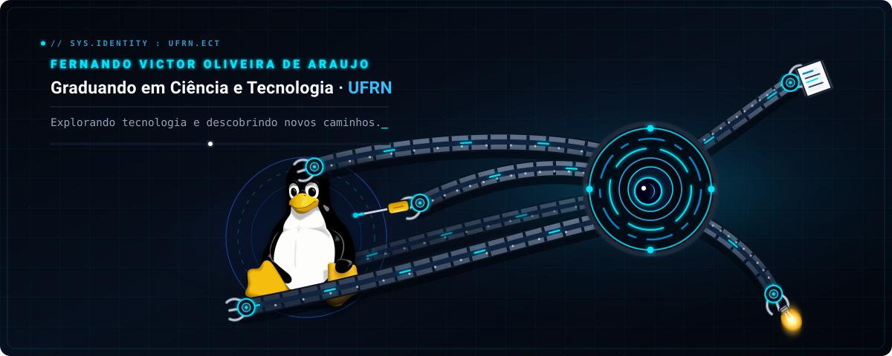

  <!-- Usa o SVG vetorial animado (60 FPS, nitidez máxima e brilho neon) -->
  

 

  <!-- Badges no mesmo tema escuro + ciano (#00E5FF) do banner -->
  
  
  
  

 

  Tux: <a href="https://commons.wikimedia.org/wiki/File:Tux.svg">Larry Ewing, Simon Budig e Garrett LeSage (CC0)</a>. A animação e design foram criados para este perfil.

